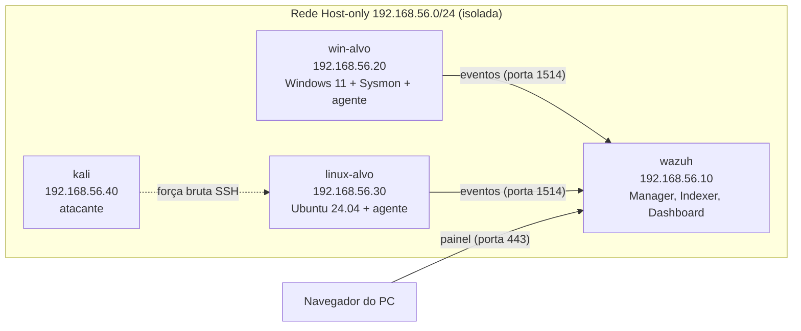

# SOC Home Lab com Wazuh

Laboratório de SOC montado em casa para praticar detecção e investigação de ataques. Um SIEM Wazuh coleta logs de um Windows 11 (com Sysmon) e de um Ubuntu, recebe 9 cenários de ataque simulados e usa 3 regras de detecção que eu escrevi, mapeadas para o MITRE ATT&CK.

## Arquitetura

| VM | Sistema | IP | Função |
|----|---------|----|--------|
| wazuh | Ubuntu Server 24.04 | 192.168.56.10 | Wazuh 4.14 all-in-one: manager, indexer e dashboard |
| win-alvo | Windows 11 Enterprise | 192.168.56.20 | Alvo Windows, com Sysmon e agente Wazuh |
| linux-alvo | Ubuntu Server 24.04 | 192.168.56.30 | Alvo Linux, com SSH e agente Wazuh |
| kali | Kali Linux | 192.168.56.40 | Máquina atacante |

Todas as VMs rodam no VirtualBox, numa rede Host-only isolada. Os ataques só alcançam máquinas do próprio lab.

## Ferramentas

Wazuh 4.14, Sysmon (configuração da SwiftOnSecurity), VirtualBox 7.2, Kali Linux, Windows 11 Enterprise (avaliação) e Ubuntu Server 24.04.

## Cenários

| Cenário | Técnica | Evento | rule.id | rule.level | rule.description | Ligação com o Security+ | Alertou? |
|---------|---------|--------|---------|------------|------------------|-------------------------|----------|
| [1. Força bruta no Windows e bloqueio de conta](cenarios/01-forca-bruta-windows.md) | T1110.001 | 4625, 4740 | 60122, 60115 | 5, 9 | Logon Failure - Unknown user or bad password, User account locked out (multiple login errors) | Brute force e account lockout | Sim |
| [2.1 Força bruta no SSH do Linux a partir do Kali, com usuário que não existe](cenarios/02-forca-bruta-ssh.md) | T1110.001 | auth.log (sshd) | 5710, 5712 | 5, 10 | sshd: Attempt to login using a non-existent user, sshd: brute force trying to get access to the system. Non existent user | Brute force | Sim |
| [2.2 Força bruta no SSH do Linux a partir do Kali, com usuário que existe](cenarios/02-forca-bruta-ssh.md) | T1110.001 | auth.log (sshd) | 5760, 5763 | 5, 10 | sshd: authentication failed, sshd: brute force trying to get access to the system. Authentication failed | Brute force | Sim |
| [3. Conta criada e adicionada ao grupo de administradores](cenarios/03-conta-criada-e-promovida.md) | T1136.001, T1098 | 4720, 4732 | 60109, 60170, 60154 | 8, 5, 12 | User account enabled or created, Users Group Changed, Administrators Group Changed | Persistência e escalonamento de privilégio | Sim |
| [4. Apagar todos os logs](cenarios/04-log-apagado.md) | T1070.001 | 1102 | 63103 | 5 | The audit log was cleared | Missing logs | Sim |
| [5. Serviço novo criado](cenarios/05-servico-novo.md) | T1543.003 | 7045 | 61138 | 5 | New Windows Service Created | Persistência | Sim |
| [6. Tarefa agendada criada](cenarios/06-tarefa-agendada.md) | T1053.005 | 4698 | 60228 | 4 | A scheduled task was created | Persistência | Sim |
| [7. PowerShell saindo para a internet](cenarios/07-powershell-internet.md) | T1059.001, T1071.001 | Sysmon 3 | - | 0 | - | Detecção de um malware ligando para o servidor de C2 | Não (falso negativo, corrigido pela regra 100110) |
| [8. Arquivo crítico alterado](cenarios/08-arquivo-critico-alterado.md) | T1136.001 | FIM do /etc/passwd, auth.log | 550, 5901, 5902 | 7, 8, 8 | Integrity checksum changed, New group added to the system, New user added to the system | File Integrity Monitoring (FIM) | Sim |

## Regras próprias

| Regra | Cenário | Antes | Depois | MITRE |
|-------|---------|-------|--------|-------|
| 100100 | 4. Log apagado | 63103, nível 5 | 100100, nível 12 | T1070.001 |
| 100110 | 7. PowerShell saindo para a internet | Sem alerta (92101, nível 0) | 100110, nível 10 | T1059.001, T1071.001 |
| 100120 | 3. Conta criada e promovida | 60109 e 60154 separados | 100120, nível 14 | T1136.001, T1098 |
| 40112 (padrão) | 2.1 Força bruta seguida de login com sucesso | Não testado | 40112, nível 12 | T1110, T1078 |

O arquivo completo está em [regras/local_rules.xml](regras/local_rules.xml).

## O que eu aprendi

- **VM do Windows com tela preta:** a Integridade da Memória do Windows deixava o hipervisor do Hyper-V ligado, e o VirtualBox rodava num modo lento e instável. Resolvi desligando a Integridade da Memória e o hipervisor (`bcdedit /set hypervisorlaunchtype off`) durante o uso do lab.
- **Resumo da instalação do Wazuh perdido:** fechei a sessão do tmux com `exit` e perdi a tela com a senha do admin. Recuperei a senha no `wazuh-install-files.tar` e passei a sair do tmux com Ctrl+B e D, que mantém a sessão viva.
- **Painel com "No API available to connect":** a API do manager (porta 55000) ainda não tinha subido. Aprendi a conferir com `systemctl is-active wazuh-manager` e `ss -tlnp` antes de culpar o painel.
- **Bloqueio de conta (4740) invisível no painel:** o Windows tinha registrado o evento, mas filtros de uma busca anterior continuavam ligados e escondiam o resultado. Hoje confiro a linha de filtros antes de cada busca.
- **Eventos 4732 sumindo na busca pela conta nova:** no 4732, o `targetUserName` é o nome do grupo e a conta aparece só como SID (`memberSid`). Passei a buscar por grupos de regras, e não pelo nome da conta.
- **Eventos depende da subcategoria:** o 4698 (tarefa agendada) depende da subcategoria de auditoria Other Object Access Events, que vem desligada.
- **Falso negativo do PowerShell:** o Sysmon registrava o PowerShell conectando na internet, mas a regra padrão do Wazuh para esse evento tem nível 0 e não gera alerta. Escrevi a regra 100110.
- **Regra 100110 que nunca disparava:** a primeira versão era filha da 61605, mas o evento seguia pela 92101, uma regra irmã mais específica e carregada antes. Mudei a regra mãe para a 92101.
- **Alerta de força bruta seguida de sucesso "faltando":** a regra 40112 já existia e funcionava, mas fica no grupo attacks, fora da busca por sshd, e substitui o alerta de login com sucesso (5715). Confirmei com o `wazuh-logtest` e pelo `alerts.json`.
- **FIM demorando horas para alertar:** o monitoramento de integridade do Wazuh varre os arquivos a cada 12 horas por padrão. Ativei o tempo real no /etc.
- **Regra 100120 mais ampla do que devia:** o teste negativo mostrou que a regra mãe cobre adição e remoção de membros do Administrators. Restringi ao evento 4732.

## Aviso

Todos os testes foram feitos em máquinas virtuais minhas, em uma rede isolada.

## Autora

Isabella Novaes, CompTIA Security+ e Network+. [LinkedIn](https://www.linkedin.com/in/isabellanovaes2003)
