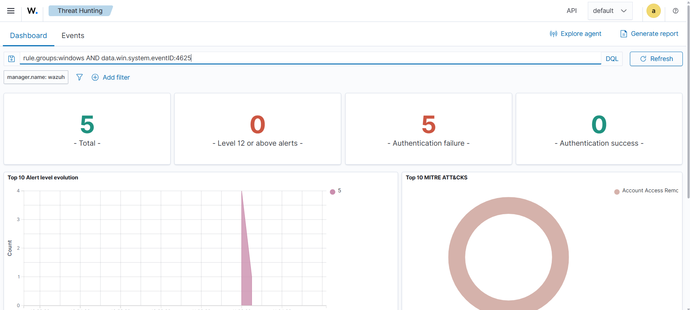
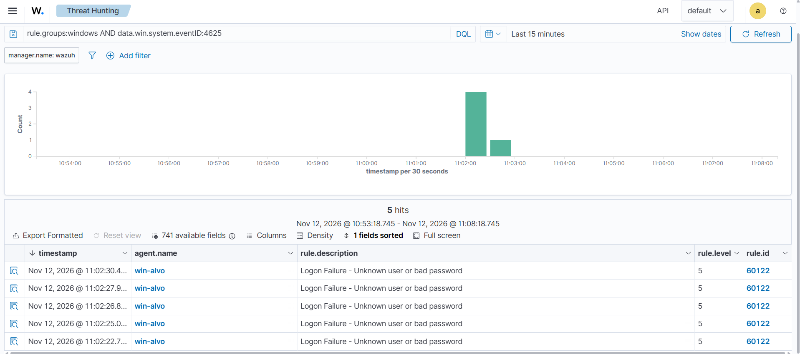
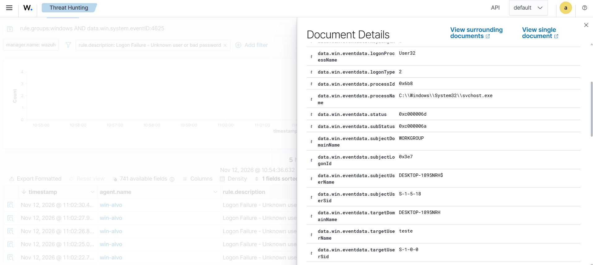
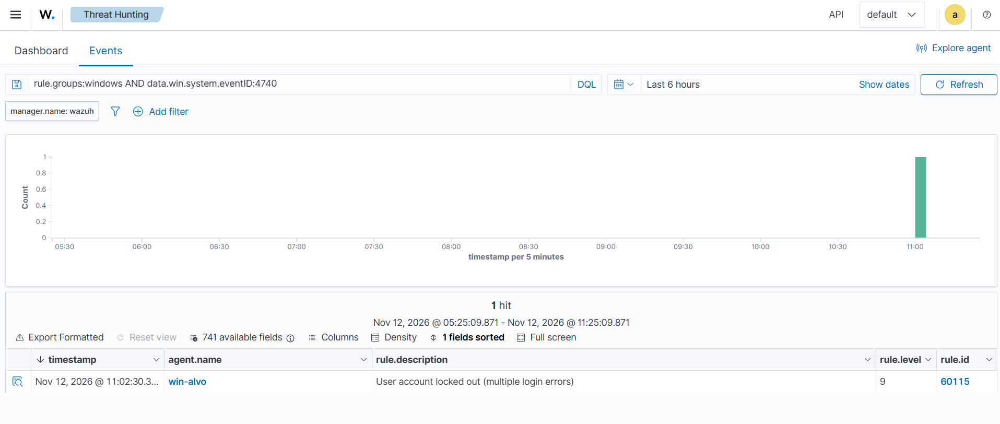
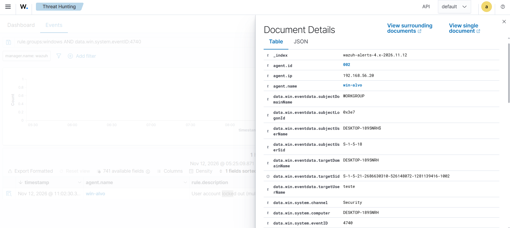

# Cenário 1: força bruta no Windows e bloqueio de conta

## O que simulei

Errei a senha de uma conta local do Windows 5 vezes seguidas até ela ser bloqueada. É o que acontece quando alguém tenta adivinhar a senha de uma conta, à mão ou com uma ferramenta.

## Técnica

T1110.001 Brute Force: Password Guessing, tática Credential Access.

O Wazuh também associou os alertas à T1531 (Account Access Removal), porque o bloqueio impede o dono legítimo de entrar.

## Como gerei

Criei uma conta de teste separada, para não arriscar bloquear a minha conta de trabalho na VM:

```powershell
net user teste <senha> /add
```

Na tela de login da win-alvo, escolhi a conta teste e digitei a senha errada até o Windows bloquear a conta. A política de bloqueio foi configurada na montagem do lab (ver [config/auditoria-windows.md](../config/auditoria-windows.md)): 5 senhas erradas em 15 minutos bloqueiam a conta por 15 minutos.

## O que o Wazuh detectou

| Evento | Regra | Nível | Descrição |
|---|---|---|---|
| 4625 | 60122 | 5 | Logon Failure - Unknown user or bad password |
| 4740 | 60115 | 9 | User account locked out (multiple login errors) |

Foram 5 falhas de logon em 8 segundos (11:02:22 a 11:02:30) e, no mesmo segundo da última falha, o bloqueio da conta.





No evento de falha aberto, os campos mais úteis são:

- `targetUserName: teste`: a conta que estava sendo atacada.
- `logonType: 2`: logon interativo, na própria tela do computador.
- `subStatus: 0xc000006a`: o usuário existe e a senha estava errada. Se a conta não existisse, o código seria outro (0xc0000064).





No evento de bloqueio, o `subjectUserName` é `DESKTOP-1895NRH$`, a própria máquina. Quem bloqueia a conta é o sistema, por causa da política, e não uma pessoa.



Um tropeço no caminho: na primeira busca pelo 4740, o painel não mostrava nada, mesmo com o evento registrado no Windows. Dois filtros de uma busca anterior continuavam ligados e escondiam o resultado.

## Como eu investigaria

1. Ver qual conta foi atacada e se ela é importante (administrador, conta de serviço).
2. Ver de onde vieram as tentativas: o tipo de logon e, num ataque pela rede, o IP de origem.
3. Medir o ritmo: 5 tentativas em 8 segundos não é uma pessoa esquecendo a senha.
4. Procurar um logon com sucesso (4624) da mesma origem depois das falhas. Se existir, o atacante acertou a senha e o caso vira incidente.

## Como mitigaria

- Manter a política de bloqueio por tentativas, como neste lab.
- Exigir senhas fortes e MFA.
- Limitar quais contas podem fazer logon remoto.

## Ligação com o Security+

Ataques a senhas (brute force) e controles de conta (account lockout).
