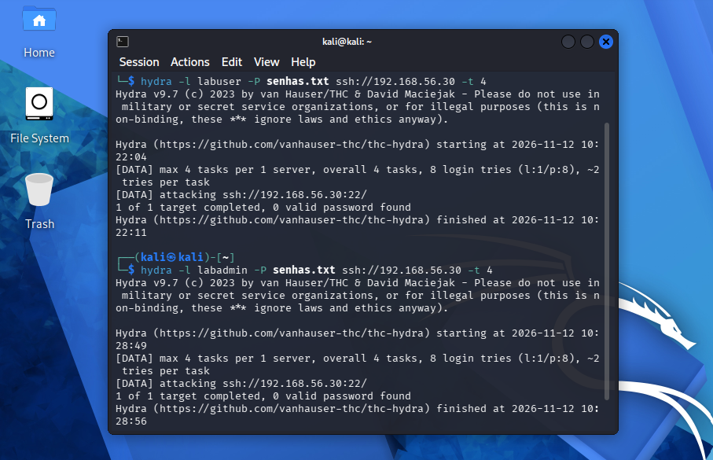
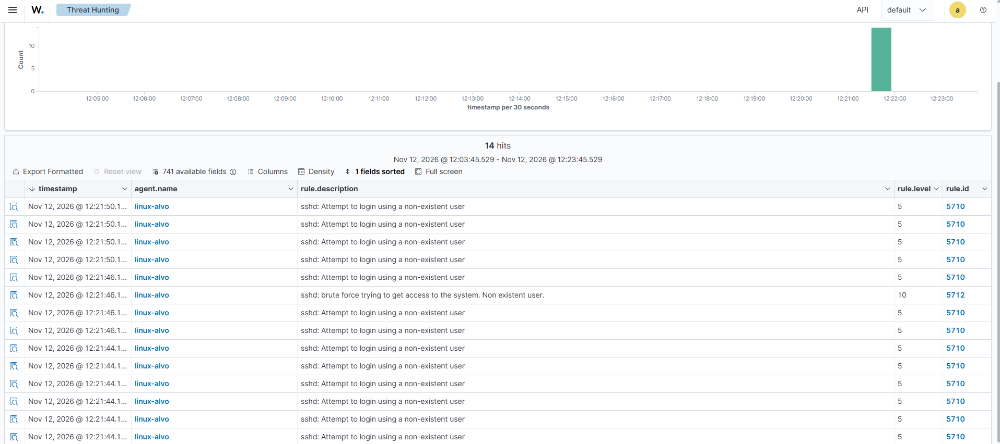
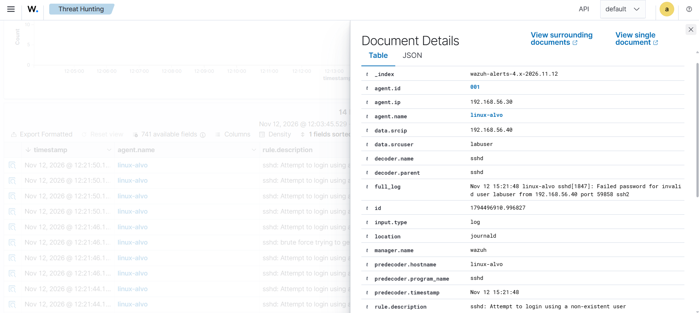
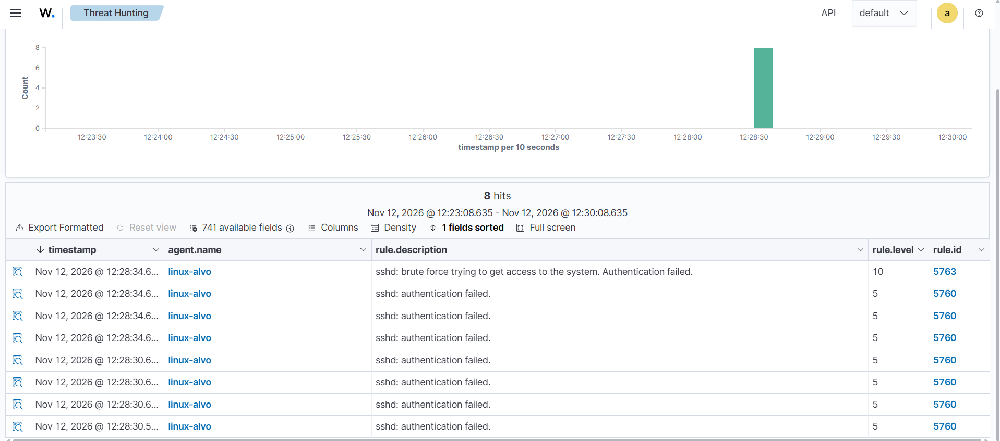
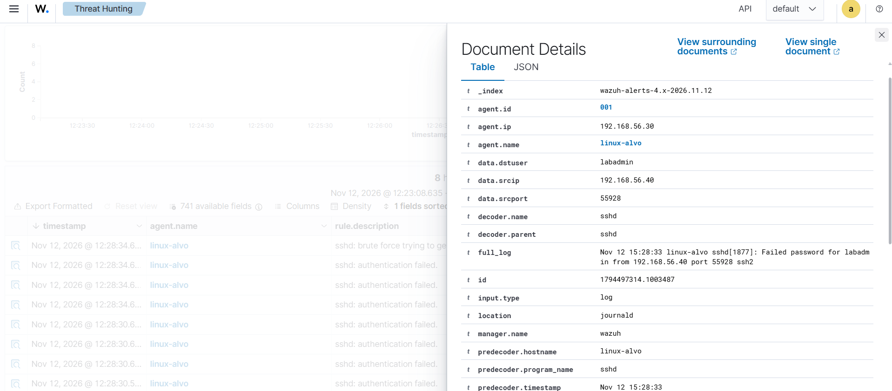
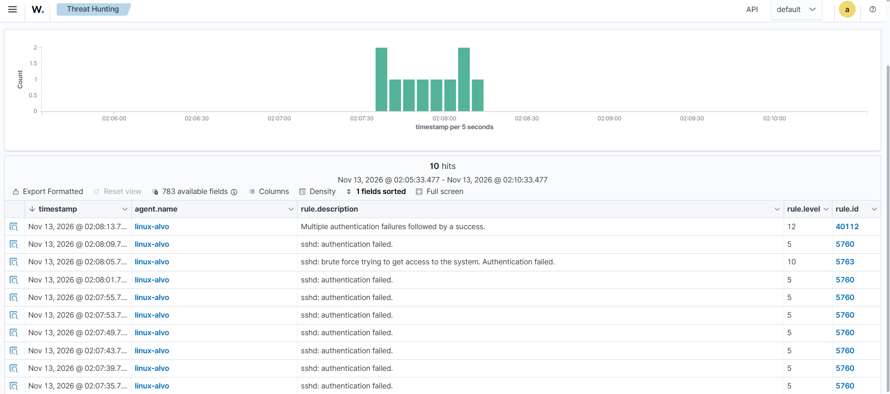
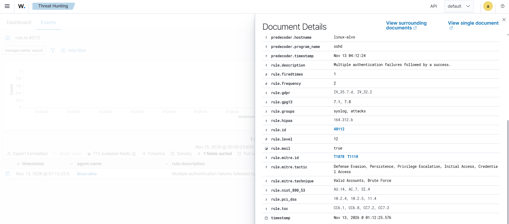

# Cenário 2: força bruta no SSH do Linux

## O que simulei

Tentei várias senhas contra o SSH do linux-alvo a partir do Kali, em duas situações: com um usuário que não existe na máquina e com um usuário que existe. Depois testei o caso mais grave, em que as falhas terminam com um login que dá certo.

## Técnica

T1110.001 Brute Force: Password Guessing, tática Credential Access. O Wazuh também marcou T1021.004 (Remote Services: SSH). O login com sucesso depois das falhas entra em T1078 (Valid Accounts).

## Como gerei

No Kali (192.168.56.40), usei o hydra com uma lista de 8 senhas comuns contra o SSH do linux-alvo (192.168.56.30), primeiro com o usuário `labuser`, que não existe no linux-alvo, e depois com o `labadmin`, que existe. A senha certa não estava na lista, então as duas rodadas geraram só falhas.

Para o caso de falhas seguidas de sucesso, fiz à mão, do próprio Kali: três conexões SSH com a `labadmin`, errando a senha três vezes em cada uma, e logo depois uma conexão com a senha certa.

## O que o Wazuh detectou

### 2.1 Usuário que não existe

| Regra | Nível | Descrição |
|---|---|---|
| 5710 | 5 | sshd: Attempt to login using a non-existent user |
| 5712 | 10 | sshd: brute force trying to get access to the system. Non existent user |

Cada tentativa gerou uma 5710. Quando o mesmo IP passou de 8 tentativas em 120 segundos, o Wazuh juntou tudo na 5712, de nível 10.

### 2.2 Usuário que existe

| Regra | Nível | Descrição |
|---|---|---|
| 5760 | 5 | sshd: authentication failed |
| 5763 | 10 | sshd: brute force trying to get access to the system. Authentication failed |

A mesma lógica, mas com outra dupla de regras, porque agora o log diz "Failed password for labadmin" em vez de "invalid user". No evento aberto, `data.srcip` mostra o IP do Kali e `data.dstuser` mostra a conta atacada.

### Falhas seguidas de sucesso

| Regra | Nível | Descrição |
|---|---|---|
| 40112 | 12 | Multiple authentication failures followed by a success |

Antes de escrever uma regra para esse caso, procurei se ela já existia, e existia: a 40112, padrão do Wazuh. Ela dispara quando um login com sucesso chega até 240 segundos depois de um alerta de várias falhas (como a 5763), vindo do mesmo IP.

Isso deu trabalho para enxergar. A busca `rule.groups:sshd` não mostrava a 40112, porque ela fica no grupo attacks. E o login com sucesso não aparecia como 5715, porque a 40112 é filha dela e o alerta da filha substitui o da mãe. Confirmei o que estava acontecendo com o `wazuh-logtest` e contando os alertas no `alerts.json` do manager. A busca certa é `rule.groups:sshd or rule.id:40112`.

## Como eu investigaria

1. Pegar o `srcip` e ver se é um IP interno ou externo, e se aparece em outros alertas.
2. Ver quais usuários foram tentados. Nomes que não existem indicam uma varredura genérica. Um usuário que existe indica que o atacante já conhece um login válido, o que é mais grave.
3. Procurar um login com sucesso do mesmo IP depois das falhas (a 40112). Se houver, olhar o que a sessão fez.

## Como mitigaria

- Aceitar login no SSH só por chave, desligando a senha (`PasswordAuthentication no`).
- Bloquear o IP automaticamente depois de várias falhas, com a Active Response do Wazuh ou o fail2ban.
- Não expor o SSH para a internet.

## Ligação com o Security+

Ataques a senhas (brute force) e correlação de eventos num SIEM.
