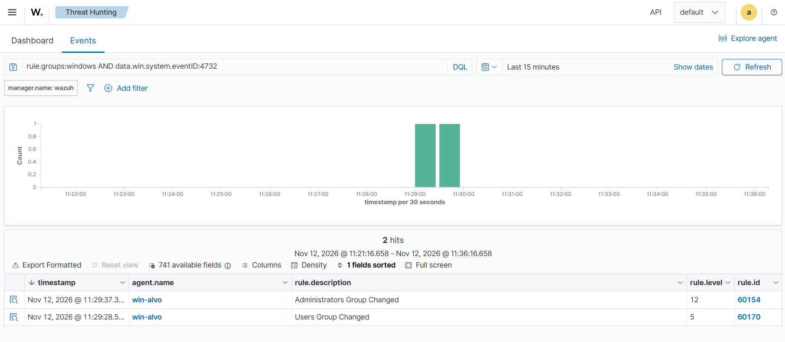
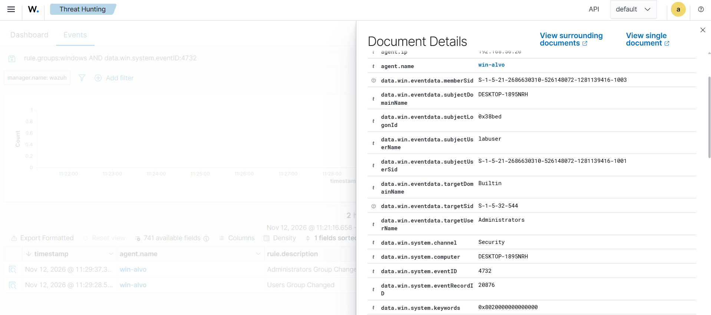
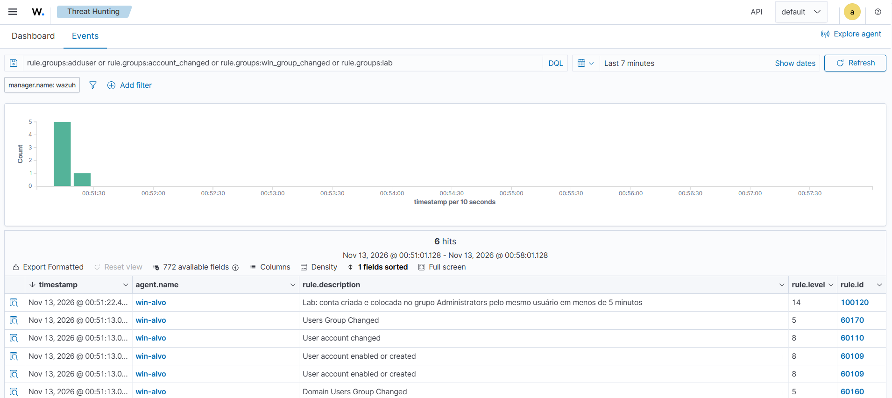
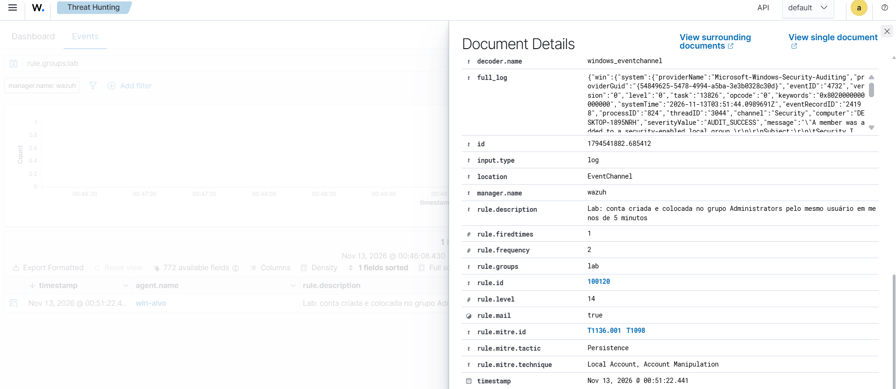
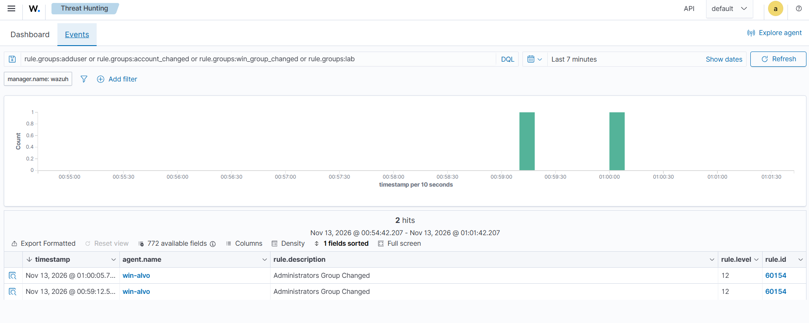

# Cenário 3: conta criada e colocada no grupo de administradores

## O que simulei

Criei uma conta local nova no Windows e coloquei essa conta no grupo Administrators logo em seguida. É um jeito comum de um invasor garantir uma porta de volta: uma conta só dele, com poder total na máquina.

## Técnica

T1136.001 Create Account: Local Account e T1098 Account Manipulation, tática Persistence.

## Como gerei

No PowerShell como administrador da win-alvo:

```powershell
net user suporte2 <senha> /add
net localgroup Administrators suporte2 /add
```

## O que o Wazuh detectou

| Evento | Regra | Nível | Descrição |
|---|---|---|---|
| 4720 | 60109 | 8 | User account enabled or created |
| 4732 | 60170 | 5 | Users Group Changed |
| 4732 | 60154 | 12 | Administrators Group Changed |

O mesmo evento 4732 ("membro adicionado a um grupo local") veio com dois níveis. Entrar no grupo Users acontece sozinho em toda conta nova, então é nível 5. Entrar no Administrators é escalada de privilégio, nível 12. O Wazuh diferencia os dois pelo SID do grupo: o Administrators é sempre S-1-5-32-544, em qualquer Windows.





No 4732, o `subjectUserName` mostra quem fez a mudança (labuser). A conta nova aparece só como SID, no `memberSid`, e o `targetUserName` é o nome do grupo. Por isso uma busca pelo nome da conta nova não encontra esses eventos.

### A regra que eu escrevi: 100120

Com as regras padrão, a criação da conta e a promoção a administrador chegam como alertas separados. Escrevi uma regra que junta os dois quando acontecem com menos de 5 minutos de diferença, feitos pelo mesmo usuário:

```xml
<rule id="100120" level="14" timeframe="300">
  <if_group>win_group_changed</if_group>
  <field name="win.eventdata.targetSid">^S-1-5-32-544$</field>
  <field name="win.system.eventID">^4732$</field>
  <if_matched_group>adduser</if_matched_group>
  <same_field>win.eventdata.subjectUserName</same_field>
  <description>Lab: conta criada e colocada no grupo Administrators pelo mesmo usuário em menos de 5 minutos</description>
  <mitre>
    <id>T1136.001</id>
    <id>T1098</id>
  </mitre>
</rule>
```

Testei com uma conta nova, `suporte3`. A conta foi criada às 00:51:13 e a 100120 disparou às 00:51:22, com nível 14, no lugar da 60154. O campo `rule.frequency: 2` mostra que o alerta nasceu da correlação de dois eventos.





Na sequência completa também aparece a regra 60160, "Domain Users Group Changed". Num Windows fora de domínio, toda conta nova entra num grupo interno chamado "None", que tem o mesmo final de SID (-513) do Domain Users. O Wazuh identifica o grupo pelo SID, por isso aparece com esse nome.

### Teste negativo

Mais de 5 minutos depois da criação, tirei a suporte3 do Administrators e coloquei de volta. Como não houve conta criada na janela de 5 minutos, apareceu só a 60154 comum, como esperado.



Esse teste mostrou também que a regra mãe (60154) casa tanto com a adição (4732) quanto com a remoção (4733) de membros. Por isso acrescentei a linha que restringe a minha regra ao evento 4732.

## Como eu investigaria

1. Ver quem criou a conta (`subjectUserName`) e de qual sessão.
2. Conferir se havia um pedido aprovado para essa conta. Conta de administrador criada sem pedido é incidente.
3. Ver o que a conta nova fez depois: logons, programas executados, outras contas criadas.

## Como mitigaria

- Dar privilégio de administrador só a quem precisa (menor privilégio).
- Revisar periodicamente os membros do Administrators.
- Manter alerta de nível alto para mudanças em grupos privilegiados, como a 100120.

## Ligação com o Security+

Escalada de privilégio, persistência e gestão de contas (least privilege).
