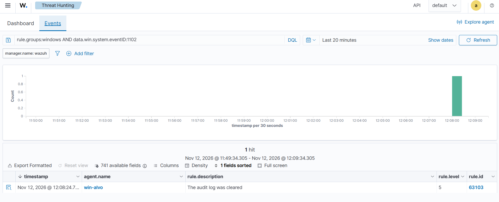
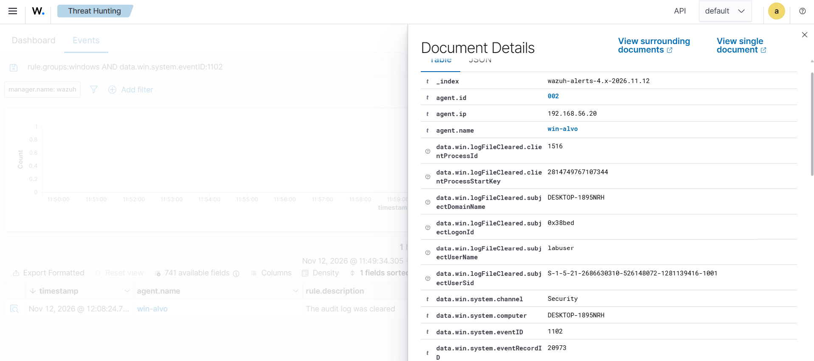
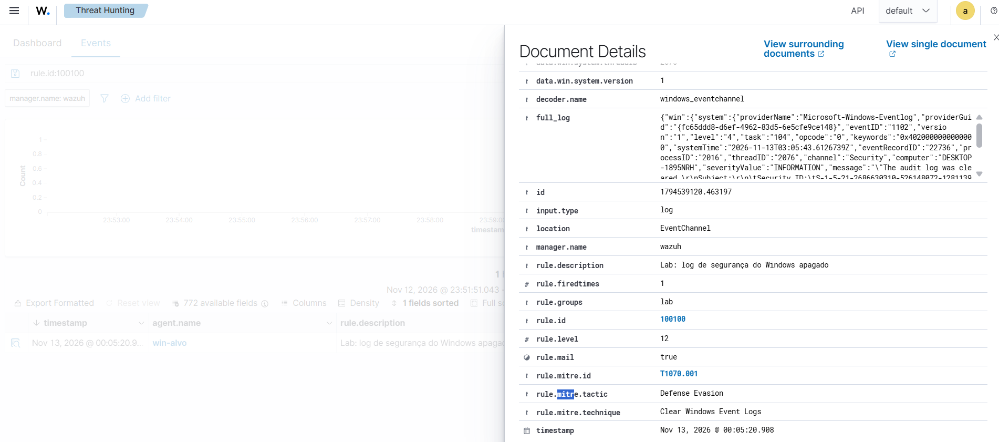
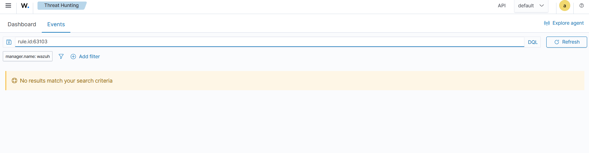

# Cenário 4: log de segurança do Windows apagado

## O que simulei

Apaguei o log Security do Windows, que é o que um invasor faz para esconder o que fez na máquina.

## Técnica

T1070.001 Indicator Removal: Clear Windows Event Logs, tática Defense Evasion.

## Como gerei

No PowerShell como administrador da win-alvo:

```powershell
wevtutil cl Security
```

## O que o Wazuh detectou

| Evento | Regra | Nível | Descrição |
|---|---|---|---|
| 1102 | 63103 (padrão) | 5 | The audit log was cleared |
| 1102 | 100100 (minha) | 12 | Lab: log de segurança do Windows apagado |

O evento 1102 traz quem apagou o log (`subjectUserName: labuser`). Mesmo com o log local apagado, os eventos anteriores continuaram no Wazuh, porque o agente já tinha mandado tudo para o servidor. É para isso que serve centralizar os logs num SIEM.





### A regra que eu escrevi: 100100

Com a regra padrão, o log apagado tinha nível 5, o mesmo de uma falha de login comum. Escrevi uma regra filha que sobe o nível para 12:

```xml
<rule id="100100" level="12">
  <if_sid>60117,63103</if_sid>
  <description>Lab: log de segurança do Windows apagado</description>
  <mitre>
    <id>T1070.001</id>
  </mitre>
</rule>
```

Ela não testa nenhum campo, porque as duas mães já casam só com o 1102. São duas mães porque o Wazuh tem uma regra para o 1102 vindo do canal Security (60117) e outra para o 1102 vindo do canal do Eventlog (63103). A filha cobre os dois caminhos.



Depois da regra, a busca pela 63103 no mesmo período voltou vazia: quando a filha casa, o alerta dela substitui o da mãe.



## Como eu investigaria

1. Ver no evento quem apagou o log e em qual máquina.
2. Buscar no Wazuh tudo o que aconteceu nessa máquina antes do apagamento, porque esses eventos já estavam guardados no servidor.
3. Conferir se havia uma manutenção aprovada. Sem isso, tratar como incidente.

## Como mitigaria

- Mandar os logs para fora da máquina, para um SIEM, como neste lab.
- Limitar quem pode limpar logs.
- Manter o alerta de log apagado com nível alto.

## Ligação com o Security+

Indicadores de comprometimento: missing logs.
