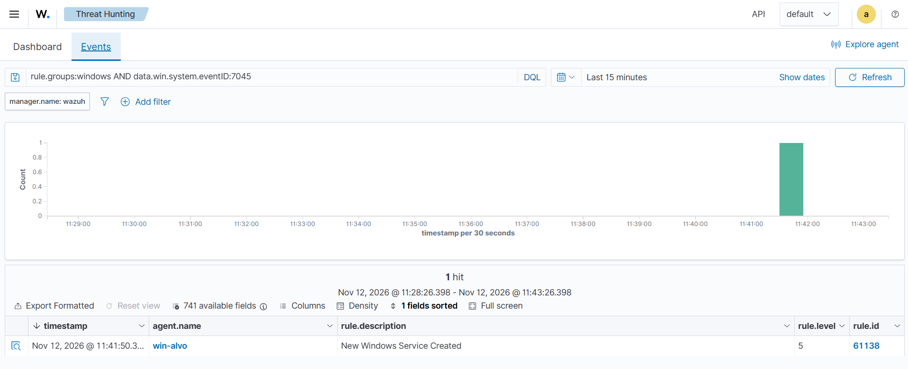
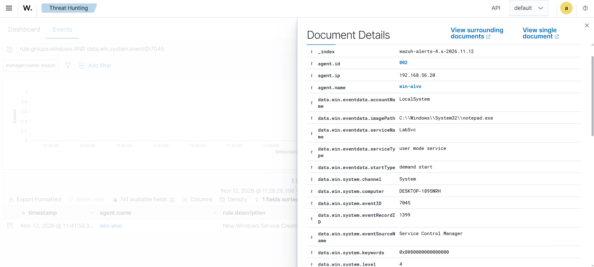

# Cenário 5: serviço novo criado

## O que simulei

Criei um serviço novo no Windows. Serviços rodam em segundo plano, podem iniciar sozinhos no boot e por padrão rodam como SYSTEM, a conta com mais poder na máquina. Por isso são um jeito comum de um atacante continuar na máquina depois de um reboot. Ferramentas de movimento lateral, como o PsExec, também criam um serviço na máquina de destino.

## Técnica

T1543.003 Create or Modify System Process: Windows Service, tática Persistence.

## Como gerei

No PowerShell como administrador da win-alvo, criei um serviço que roda um programa inofensivo, o Bloco de Notas:

```powershell
sc.exe create LabSvc binPath= "C:\Windows\System32\notepad.exe"
```

O espaço depois de `binPath=` é obrigatório na sintaxe do `sc.exe`.

## O que o Wazuh detectou

| Evento | Regra | Nível | Descrição |
|---|---|---|---|
| 7045 | 61138 | 5 | New Windows Service Created |

O 7045 vem do log System, e não do Security, e não depende de nenhuma configuração de auditoria.





No evento aberto aparecem os campos que um analista olha primeiro:

| Campo | Valor | Por que importa |
|---|---|---|
| `serviceName` | LabSvc | Nome desconhecido ou imitando um serviço do Windows é suspeito |
| `imagePath` | C:\Windows\System32\notepad.exe | O programa que o serviço roda. Caminho em pasta temporária ou de usuário é sinal de alerta |
| `startType` | demand start | Se fosse auto start, iniciaria sozinho a cada boot |
| `accountName` | LocalSystem | O serviço roda com o nível máximo de privilégio |

## Como eu investigaria

1. Olhar o `imagePath`: onde está o programa, se é assinado e o que ele faz.
2. Descobrir quem criou o serviço. O 7045 não traz o usuário, mas o Sysmon (evento 1) mostra o processo `sc.exe` e quem o executou.
3. Comparar com a lista de softwares instalados pela equipe. Todo programa legítimo também gera um 7045 na instalação, e o trabalho é separar os dois casos.

## Como mitigaria

- Restringir quem é administrador, porque criar serviço exige esse privilégio.
- Usar uma lista de programas permitidos (AppLocker ou WDAC).
- Manter o monitoramento do 7045.

## Ligação com o Security+

Persistência e indicadores de comprometimento em endpoints.
