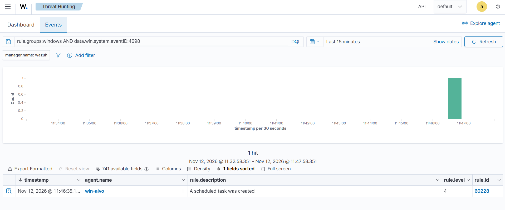
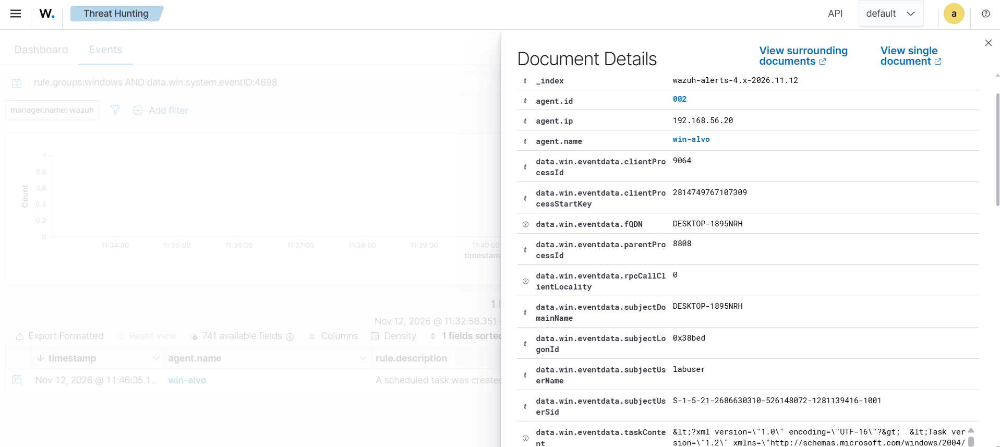

# Cenário 6: tarefa agendada criada

## O que simulei

Criei uma tarefa agendada que roda um programa toda vez que alguém faz login. Como o serviço do cenário 5, é um jeito de continuar na máquina depois de um reboot. A tarefa agendada é ainda mais comum em ataques reais, porque é fácil de criar, aceita vários gatilhos e se mistura com as dezenas de tarefas legítimas que o Windows já tem.

## Técnica

T1053.005 Scheduled Task/Job: Scheduled Task, tática Persistence.

## Como gerei

No PowerShell como administrador da win-alvo:

```powershell
schtasks /create /tn LabTask /tr notepad.exe /sc onlogon
```

- `/tn LabTask`: o nome da tarefa.
- `/tr notepad.exe`: o programa que ela roda.
- `/sc onlogon`: quando ela roda, a cada login.

Até a limpeza, o Bloco de Notas abria sozinho a cada login na VM. Era a persistência funcionando.

## O que o Wazuh detectou

| Evento | Regra | Nível | Descrição |
|---|---|---|---|
| 4698 | 60228 | 4 | A scheduled task was created |

O 4698 só é gravado com a subcategoria de auditoria Other Object Access Events ligada, que vem desligada no Windows (ver [config/auditoria-windows.md](../config/auditoria-windows.md)).





O campo mais rico do evento é o `taskContent`, que traz o XML completo da tarefa. Dentro dele estão o comando (`<Command>notepad.exe</Command>`) e o gatilho (`<LogonTrigger>`). O `subjectUserName` mostra quem criou a tarefa (labuser).

O nível 4 da regra padrão é baixo para algo que costuma ser persistência. Num ambiente real, eu subiria o nível quando o comando da tarefa apontasse para PowerShell, pastas temporárias ou downloads.

## Como eu investigaria

1. Ler o `taskContent`: qual comando roda e com qual gatilho. PowerShell com texto codificado, caminhos em `AppData` ou `Temp` e downloads da internet são os sinais mais comuns de tarefa maliciosa.
2. Ver quem criou a tarefa e se essa pessoa costuma fazer isso.
3. Procurar a mesma tarefa em outras máquinas, porque atacantes costumam repetir o mesmo nome.

## Como mitigaria

- Restringir quem é administrador.
- Manter a auditoria do 4698 ligada.
- Revisar periodicamente as tarefas agendadas fora do padrão da empresa.

## Ligação com o Security+

Persistência e indicadores de comprometimento em endpoints.
