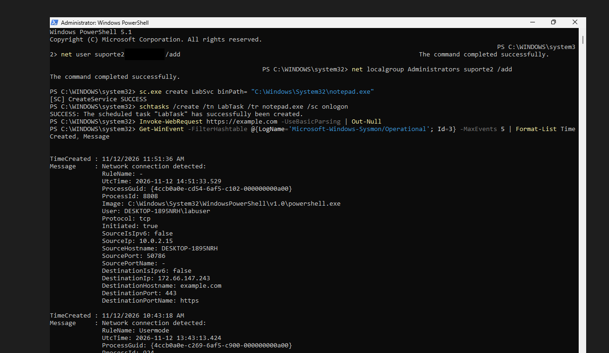
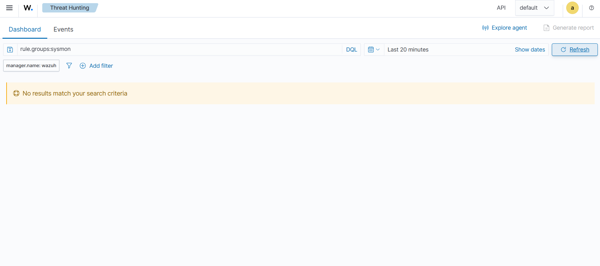
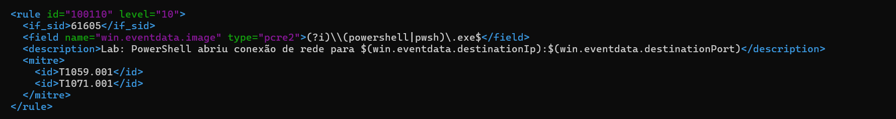
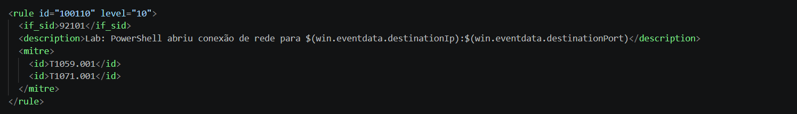
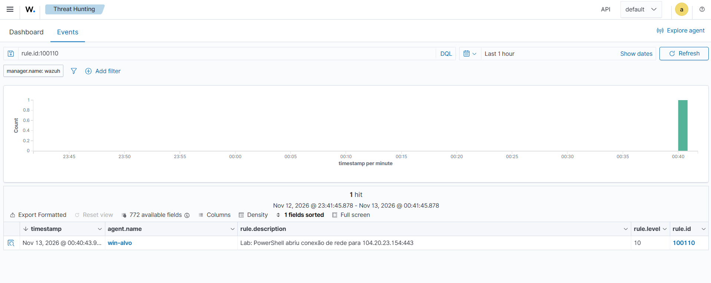
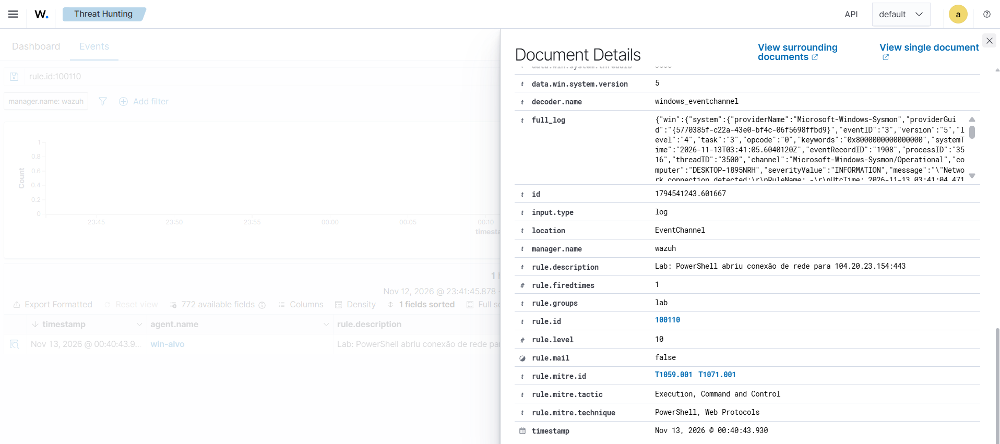

# Cenário 7: PowerShell saindo para a internet

## O que simulei

Fiz o PowerShell abrir uma conexão HTTPS para um site externo. É como muitos ataques baixam a segunda parte de um malware ou falam com o servidor de comando e controle (C2). No lab, o destino foi o example.com, um site público de teste.

## Técnica

T1059.001 Command and Scripting Interpreter: PowerShell, tática Execution, e T1071.001 Application Layer Protocol: Web Protocols, tática Command and Control.

## Como gerei

No PowerShell da win-alvo:

```powershell
Invoke-WebRequest https://example.com -UseBasicParsing | Out-Null
```

## O que aconteceu: um falso negativo

O Sysmon registrou a conexão (evento 3), com tudo o que um analista precisa:

| Campo | Valor |
|---|---|
| `Image` | C:\Windows\System32\WindowsPowerShell\v1.0\powershell.exe |
| `User` | DESKTOP-1895NRH\labuser |
| `DestinationHostname` | example.com |
| `DestinationPort` | 443 |
| `Initiated` | true (a conexão partiu da VM) |



O agente mandou o evento para o Wazuh, mas nenhum alerta apareceu:



O Wazuh só guarda como alerta o evento que casa com uma regra de nível acima de zero, e as regras padrão desse caminho têm nível 0. Faz sentido como padrão, porque um Windows normal abre centenas de conexões por hora. Mas uma conexão do PowerShell para fora merece atenção.

## A regra que eu escrevi: 100110

### Primeira versão, que não funcionou

Procurei a regra que recebe o evento 3 do Sysmon e achei a 61605, a regra genérica desse evento. Escrevi uma filha dela, testando o caminho do programa:



A regra carregou sem erro, mas nunca disparou. O motivo: o Wazuh tem outra filha da 61605, mais específica, a 92101 ("Powershell process communicating over TCP"), também de nível 0. Quando duas regras irmãs casam com o mesmo evento, o Wazuh segue pela que foi carregada primeiro, e as oficiais carregam antes das minhas. O evento sempre descia pela 92101, e a minha regra nunca era testada.

### Versão final

A correção foi trocar a mãe para a 92101. Como ela já testa que o processo é o powershell.exe e que a conexão é TCP, a minha regra ficou sem nenhum campo, só trocando o nível, a descrição e o MITRE:



O `$(...)` na descrição é trocado pelo valor do campo na hora do alerta, então o próprio alerta já mostra para onde foi a conexão.

| Regra | Nível | Descrição |
|---|---|---|
| 100110 | 10 | Lab: PowerShell abriu conexão de rede para 104.20.23.154:443 |





Num ambiente real, nível 10 para toda conexão do PowerShell geraria barulho, porque scripts de administração também usam o PowerShell para baixar coisas. O próximo passo seria criar exceções para destinos conhecidos da empresa.

## Como eu investigaria

1. Ver a reputação do destino (IP e domínio) e se ele aparece em outras máquinas.
2. Achar o processo pai e o comando completo no Sysmon (evento 1), para saber o que chamou o PowerShell.
3. Ver qual usuário estava logado e se aquilo faz parte do trabalho dele.

## Como mitigaria

- Bloquear a saída direta para a internet, obrigando a passar por um proxy.
- Ligar o registro de scripts do PowerShell (Script Block Logging).
- Restringir o PowerShell para usuários comuns (AppLocker ou Constrained Language Mode).

## Ligação com o Security+

Indicadores de comprometimento, comando e controle (C2) e falsos negativos na detecção.
