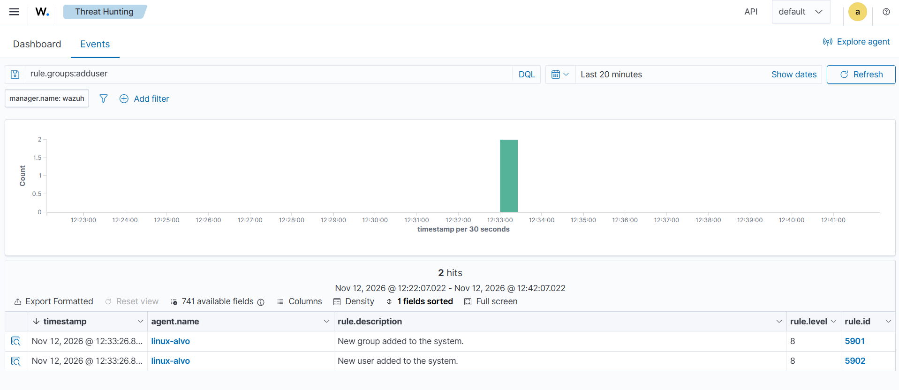
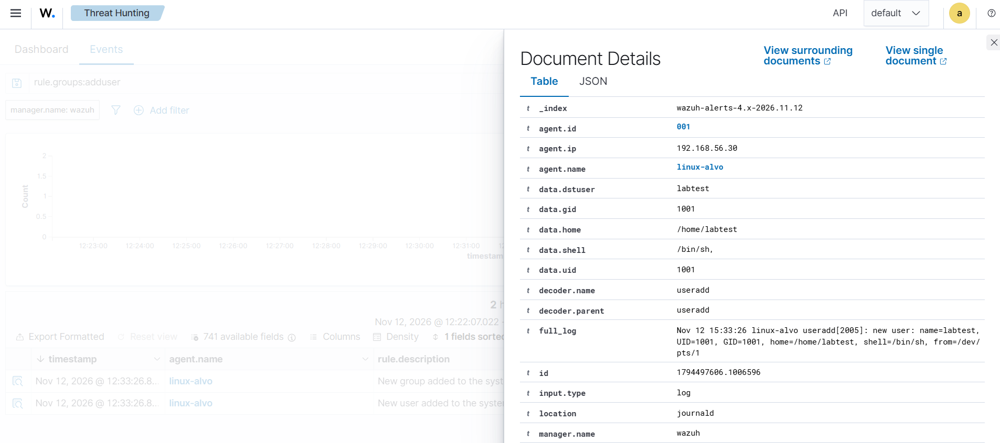
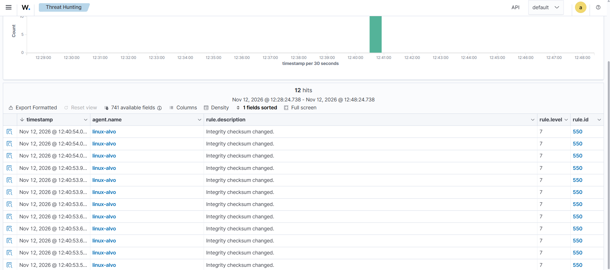
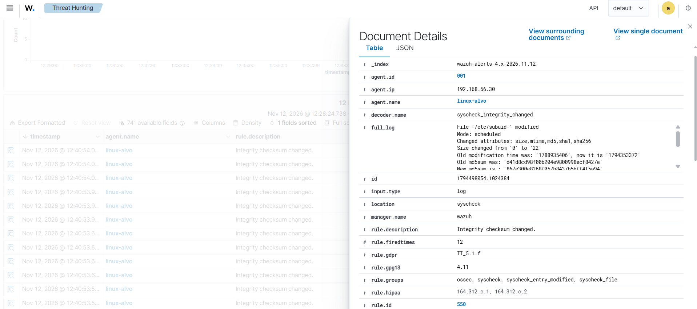

# Cenário 8: arquivo crítico alterado no Linux

## O que simulei

Criei um usuário novo no linux-alvo, o que altera o /etc/passwd e outros arquivos de contas do sistema. Um atacante faz isso para ter uma conta própria na máquina. O objetivo do cenário foi ver o ataque por dois lados: pelo log de autenticação e pelo monitoramento de integridade de arquivos (FIM).

## Técnica

T1136.001 Create Account: Local Account, tática Persistence. Para os alertas de arquivo alterado, o Wazuh usou a T1565.001 (Stored Data Manipulation).

## Como gerei

No linux-alvo:

```bash
sudo useradd labtest
```

## O que o Wazuh detectou

### Pelo log de autenticação, na hora

| Regra | Nível | Descrição |
|---|---|---|
| 5901 | 8 | New group added to the system |
| 5902 | 8 | New user added to the system |

O `useradd` cria o usuário e também um grupo com o mesmo nome, e registra as duas coisas no log. No evento aberto aparecem o UID, o GID, a pasta pessoal (/home/labtest) e o shell da conta nova.





### Pelo FIM, que demorou

| Regra | Nível | Descrição |
|---|---|---|
| 550 | 7 | Integrity checksum changed |

O FIM do Wazuh não alertou na hora. Por padrão ele varre os arquivos a cada 12 horas e compara com a varredura anterior. Forcei uma varredura no manager com `agent_control -r -a`, e apareceram 12 alertas.



São 12 porque o `useradd` mexe em 6 arquivos e guarda uma cópia de segurança de cada um, com um traço no fim do nome (por exemplo, /etc/passwd-):

| Arquivo | O que guarda |
|---|---|
| /etc/passwd | A lista de usuários |
| /etc/shadow | As senhas, em hash |
| /etc/group | Os grupos |
| /etc/gshadow | As senhas dos grupos |
| /etc/subuid e /etc/subgid | Faixas de IDs extras do usuário, usadas por containers |



Depois disso, liguei o monitoramento em tempo real para o /etc no agente do linux-alvo (ver [config/agente-linux-fim.xml](../config/agente-linux-fim.xml)), para que alterações nesses arquivos gerem alerta em segundos.

## Como eu investigaria

1. Ver qual conta nova apareceu e se havia um pedido para ela.
2. Descobrir quem rodou o comando. O uso do `sudo` fica no log de autenticação, com o usuário e o comando.
3. Tratar o /etc/shadow alterado com prioridade, porque é o arquivo das senhas.

## Como mitigaria

- Manter o FIM em tempo real nos arquivos críticos, como neste lab.
- Restringir quem pode usar o `sudo`.
- Registrar e aprovar as mudanças nos servidores (gestão de mudanças).

## Ligação com o Security+

Monitoramento de integridade de arquivos (FIM) e persistência.
